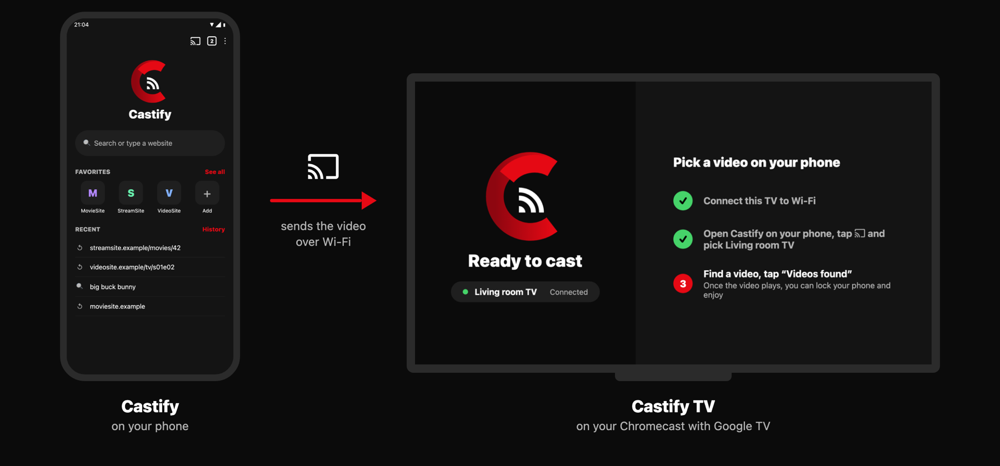

# Castify

Watch the video playing on a website on your TV. Castify is a browser for your Android
phone: it finds the video in the page and sends it to your Chromecast with Google TV, which
plays it on its own. No screen mirroring, and your phone can sleep.

  

You need two apps: **Castify TV** on the TV and **Castify** on the phone. Install the TV
one first.

## Install on your TV

For a **Chromecast with Google TV** (or any Google TV / Android TV). About 5 minutes, only
once: after that, Castify updates itself.

1. On the TV, open the **Google Play Store**, search for **Downloader** (by AFTVnews) and
   install it.
2. Open **Downloader** and allow it to install apps: when it asks, go to the settings it
   opens and turn **Downloader** on.
   - If you can't find that switch: Settings → System → About → click **Android TV OS
     build** 7 times (developer mode), then Settings → Apps → Security & restrictions →
     **Unknown sources** → turn **Downloader** on.
3. In Downloader, type the code **`8639740`** and press **Go**.
4. When the download ends, choose **Install**, then **Open**.

Castify TV now shows **Ready to cast**.

> Code not working? Type this address in Downloader instead:
> `https://github.com/7Zup/Castify/releases/latest/download/castify-tv.apk`

## Install on your phone

Android 8 or newer.

1. On your phone, open **[aftv.news/9614717](http://aftv.news/9614717)**
   (or the [direct link](https://github.com/7Zup/Castify/releases/latest/download/castify-phone.apk)).
2. Download the file, then tap it to open it.
3. Android asks to allow installs from your browser: allow it, go back, then tap
   **Install**.

## Use it

1. Phone and TV on the **same Wi-Fi**; open **Castify TV** on the TV.
2. On the phone, open Castify, tap the **Cast** button and pick your TV.
3. Go to a website, start the video, tap **Videos found**, pick the quality.

Phone and TV now play on their own: you can lock your phone.

## Why does Android warn me?

Castify isn't on the Play Store, so Android asks you to allow "unknown apps" once.
The apps come straight from this repository's
[releases](https://github.com/7Zup/Castify/releases).

## Updates

Both apps check for a new version when they start and offer to update in one tap.

## For developers

Build, architecture and release process: [`docs/development.md`](docs/development.md).

## License

Source available under the [PolyForm Noncommercial License 1.0.0](LICENSE.md): free to
read, use and modify for any noncommercial purpose; selling it or using it commercially
is not allowed.
