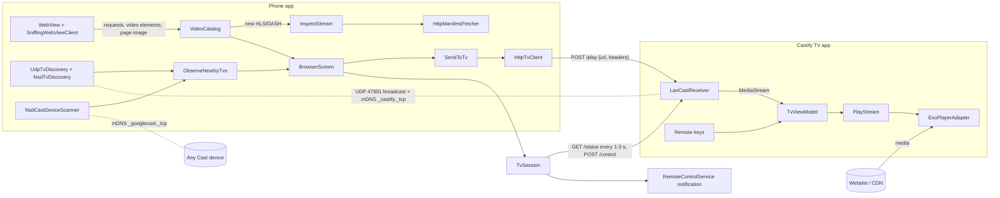

# Architecture

Decisions: ADR 0001 (native Android), ADR 0002 (own TV app instead of a Cast receiver).

## Modules

| Module | Kind | Depends on | Contains |
| --- | --- | --- | --- |
| `:core:domain` | Pure Kotlin/JVM | coroutines only | Models, `browser/` (tabs, history, favorites), `StreamClassifier`, `VideoCatalog`, `InspectStream` + HLS/DASH parsers + `Mp4Probe` + `QualityLabel`, `subtitles/` (classifier, menu, language names), `TvSession`, `BufferPolicy`, `RemoteControl`, use cases, ports |
| `:core:protocol` | Pure Kotlin/JVM | `:core:domain`, kotlinx.serialization | `PlayRequest` / `ErrorResponse`, mapping, service type & port |
| `:phone:data` | Android library | `:core:*` | `SniffingWebViewClient` (+ `BrowserEvents`), `HttpManifestFetcher`, `UdpTvDiscovery`, `NsdTvDiscovery`, `NsdCastDeviceScanner`, `NsdResolver` (shared mDNS resolve queue), `WifiNetwork`, `HttpTvClient`, `BrowserStores` (tabs, history, favorites, previews), `PrefsLastUrlStore` (legacy migration) |
| `:phone:app` | Android app | `:core:domain`, `:phone:data`, Coil, Media3 session | `AppContainer` (DI), `BrowserViewModel`, `BrowserScreen`, `ui/` (theme, remote, now-playing bar), `RemoteControlService` (media notification) |
| `:tv:data` | Android library | `:core:*`, Ktor, Media3 | `LanCastReceiver` (HTTP + NSD), `ExoPlayerAdapter` |
| `:tv:app` | Android TV app | `:core:domain`, `:tv:data` | `TvContainer` (DI), `TvViewModel`, `TvActivity` (keys), `TvScreen` |

## Ports (in `:core:domain`)

| Port | Side | Adapter |
| --- | --- | --- |
| `ManifestFetcher` | phone | `HttpManifestFetcher` |
| `TvDiscovery` | phone | `UdpTvDiscovery`, `NsdTvDiscovery` (merged by `ObserveTvDevices`) |
| `CastDeviceScanner` | phone | `NsdCastDeviceScanner` (`_googlecast._tcp`, merged with the Castify TVs by `ObserveNearbyTvs`) |
| `TvClient` (play, status, control) | phone | `HttpTvClient` |
| `TabStore` / `HistoryStore` / `FavoriteStore` | phone | `PrefsTabStore` / `PrefsHistoryStore` / `PrefsFavoriteStore` |
| `CastReceiver` | TV | `LanCastReceiver` |
| `Player` | TV | `ExoPlayerAdapter` |

## Data flow

The phone only finds the stream and sends a command. The TV downloads the media itself,
with the headers/cookies captured on the phone, so the phone can sleep.

## Platform views

The UI never imports adapters. The two platform views are bound through the composition
roots: `AppContainer.installSniffer(webView, vm)` on the phone (it forwards
`BrowserEvents` to `VideoCatalog` and the view model), `TvContainer.videoSurface`
(attach/detach a `PlayerView`) on the TV.
